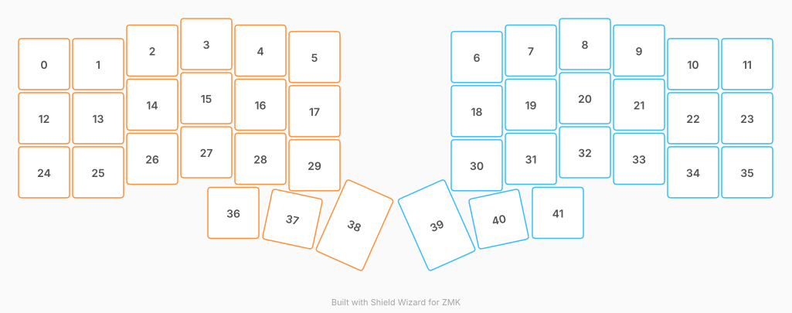

# ZMK Configuration for meowCORNE

*Generated by Shield Wizard for ZMK*



Download compiled firmware from the Actions tab. <https://zmk.dev/docs/user-setup#installing-the-firmware>

Edit your keymap <https://zmk.dev/docs/keymaps>.
User keymap is located at [`config/meowcorne.keymap`](config/meowcorne.keymap).

-----

<details>
<summary>
Shield Wizard Debug Information
</summary>

In case of broken configuration, here is the Shield Wizard internal data used to generate this configuration:

Commit: 6764e3d30a05e636ed273f525928b404e08565e9

```json
{"name":"meowCORNE","shield":"meowcorne","dongle":false,"modules":[],"layout":[{"id":"01M6S77VBXPE4RGK1947Q1T3B5","part":0,"row":0,"col":0,"w":1,"h":1,"x":0,"y":0.37,"r":0,"rx":0,"ry":0},{"id":"01M6S77VBX2RBTHQAY3CBS4D89","part":0,"row":0,"col":1,"w":1,"h":1,"x":1,"y":0.37,"r":0,"rx":0,"ry":0},{"id":"01M6S77VBXE69K57PWHPGKAFJ8","part":0,"row":0,"col":2,"w":1,"h":1,"x":2,"y":0.12,"r":0,"rx":0,"ry":0},{"id":"01M6S77VBXHXVPHNESA1BENCXC","part":0,"row":0,"col":3,"w":1,"h":1,"x":3,"y":0,"r":0,"rx":0,"ry":0},{"id":"01M6S77VBXGBXZCN828ZHJ7EWB","part":0,"row":0,"col":4,"w":1,"h":1,"x":4,"y":0.12,"r":0,"rx":0,"ry":0},{"id":"01M6S77VBYFPXG0G0W9NGYJR8X","part":0,"row":0,"col":5,"w":1,"h":1,"x":5,"y":0.24,"r":0,"rx":0,"ry":0},{"id":"01M6S77VBYVAQTANGM8RWCCVWY","part":1,"row":0,"col":6,"w":1,"h":1,"x":8,"y":0.24,"r":0,"rx":0,"ry":0},{"id":"01M6S77VBYNNFZ5JZH4W265JWZ","part":1,"row":0,"col":7,"w":1,"h":1,"x":9,"y":0.12,"r":0,"rx":0,"ry":0},{"id":"01M6S77VBYCTRZ487J6TDKZW88","part":1,"row":0,"col":8,"w":1,"h":1,"x":10,"y":0,"r":0,"rx":0,"ry":0},{"id":"01M6S77VBYCFFRWKJGEHZYKACH","part":1,"row":0,"col":9,"w":1,"h":1,"x":11,"y":0.12,"r":0,"rx":0,"ry":0},{"id":"01M6S77VBYKMY0N4TNT6X4A9PA","part":1,"row":0,"col":10,"w":1,"h":1,"x":12,"y":0.37,"r":0,"rx":0,"ry":0},{"id":"01M6S77VBY5T7GMFKGKCQQPADE","part":1,"row":0,"col":11,"w":1,"h":1,"x":13,"y":0.37,"r":0,"rx":0,"ry":0},{"id":"01M6S77VBYKNQWA3XH8GYP65G0","part":0,"row":1,"col":0,"w":1,"h":1,"x":0,"y":1.37,"r":0,"rx":0,"ry":0},{"id":"01M6S77VBY7BK27XZTCMJW7G2B","part":0,"row":1,"col":1,"w":1,"h":1,"x":1,"y":1.37,"r":0,"rx":0,"ry":0},{"id":"01M6S77VBYQ67ENDVVQYSGA99Z","part":0,"row":1,"col":2,"w":1,"h":1,"x":2,"y":1.12,"r":0,"rx":0,"ry":0},{"id":"01M6S77VBYDH39BY5SAGM782FW","part":0,"row":1,"col":3,"w":1,"h":1,"x":3,"y":1,"r":0,"rx":0,"ry":0},{"id":"01M6S77VBYQAXFYG5FK287RCAB","part":0,"row":1,"col":4,"w":1,"h":1,"x":4,"y":1.12,"r":0,"rx":0,"ry":0},{"id":"01M6S77VBYVW9YHY2MS29HR8BZ","part":0,"row":1,"col":5,"w":1,"h":1,"x":5,"y":1.24,"r":0,"rx":0,"ry":0},{"id":"01M6S77VBY5QTB1XRGBJV1FQGY","part":1,"row":1,"col":6,"w":1,"h":1,"x":8,"y":1.24,"r":0,"rx":0,"ry":0},{"id":"01M6S77VBYE3TNR5BMQ4Z4Y9CZ","part":1,"row":1,"col":7,"w":1,"h":1,"x":9,"y":1.12,"r":0,"rx":0,"ry":0},{"id":"01M6S77VBY3BTHH6DKVXGTQPZ3","part":1,"row":1,"col":8,"w":1,"h":1,"x":10,"y":1,"r":0,"rx":0,"ry":0},{"id":"01M6S77VBY5444W7KMPRT5E002","part":1,"row":1,"col":9,"w":1,"h":1,"x":11,"y":1.12,"r":0,"rx":0,"ry":0},{"id":"01M6S77VBY973ZH5ZRGB8EKJSP","part":1,"row":1,"col":10,"w":1,"h":1,"x":12,"y":1.37,"r":0,"rx":0,"ry":0},{"id":"01M6S77VBYR4M64N9VHJ3A96DF","part":1,"row":1,"col":11,"w":1,"h":1,"x":13,"y":1.37,"r":0,"rx":0,"ry":0},{"id":"01M6S77VBY1TAB9R7TK13V5MMP","part":0,"row":2,"col":0,"w":1,"h":1,"x":0,"y":2.37,"r":0,"rx":0,"ry":0},{"id":"01M6S77VBYJ8AAZ3NP8DD4233N","part":0,"row":2,"col":1,"w":1,"h":1,"x":1,"y":2.37,"r":0,"rx":0,"ry":0},{"id":"01M6S77VBYHK0V8B122FMB7XYH","part":0,"row":2,"col":2,"w":1,"h":1,"x":2,"y":2.12,"r":0,"rx":0,"ry":0},{"id":"01M6S77VBYM49CQCRM0H0Y45TN","part":0,"row":2,"col":3,"w":1,"h":1,"x":3,"y":2,"r":0,"rx":0,"ry":0},{"id":"01M6S77VBYFAT5NC8QACTT9G51","part":0,"row":2,"col":4,"w":1,"h":1,"x":4,"y":2.12,"r":0,"rx":0,"ry":0},{"id":"01M6S77VBY68MQ5D4Z70QB74J1","part":0,"row":2,"col":5,"w":1,"h":1,"x":5,"y":2.24,"r":0,"rx":0,"ry":0},{"id":"01M6S77VBYVFZNJJFK9YDTS8E2","part":1,"row":2,"col":6,"w":1,"h":1,"x":8,"y":2.24,"r":0,"rx":0,"ry":0},{"id":"01M6S77VBYHWN75N7KT0W0ZCQ1","part":1,"row":2,"col":7,"w":1,"h":1,"x":9,"y":2.12,"r":0,"rx":0,"ry":0},{"id":"01M6S77VBYTQR3AMGDNGE8QHSB","part":1,"row":2,"col":8,"w":1,"h":1,"x":10,"y":2,"r":0,"rx":0,"ry":0},{"id":"01M6S77VBYERGRPJ3J3YRNT1V1","part":1,"row":2,"col":9,"w":1,"h":1,"x":11,"y":2.12,"r":0,"rx":0,"ry":0},{"id":"01M6S77VBYTEG5RXKJ1X9Z70YE","part":1,"row":2,"col":10,"w":1,"h":1,"x":12,"y":2.37,"r":0,"rx":0,"ry":0},{"id":"01M6S77VBYMWC35MXT69MK2CFM","part":1,"row":2,"col":11,"w":1,"h":1,"x":13,"y":2.37,"r":0,"rx":0,"ry":0},{"id":"01M6S77VBZ95F1P38N0ZCDYBWF","part":0,"row":3,"col":3,"w":1,"h":1,"x":3.5,"y":3.12,"r":0,"rx":0,"ry":0},{"id":"01M6S77VBZBNC4E9ZC1EVNCMCM","part":0,"row":3,"col":4,"w":1,"h":1,"x":4.5,"y":3.12,"r":12,"rx":4.5,"ry":4.12},{"id":"01M6S77VBZ4V4MN0KC8GSBRKF4","part":0,"row":3,"col":5,"w":1,"h":1.5,"x":5.48,"y":2.83,"r":24,"rx":5.48,"ry":4.33},{"id":"01M6S77VBZ3X26BNM9BBW4XNSJ","part":1,"row":3,"col":6,"w":1,"h":1.5,"x":7.52,"y":2.83,"r":-24,"rx":8.52,"ry":4.33},{"id":"01M6S77VBZJWWJA7BQV76CEPD6","part":1,"row":3,"col":7,"w":1,"h":1,"x":8.5,"y":3.12,"r":-12,"rx":9.5,"ry":4.12},{"id":"01M6S77VBZ0N307PGWAYPQF36C","part":1,"row":3,"col":8,"w":1,"h":1,"x":9.5,"y":3.12,"r":0,"rx":0,"ry":0}],"parts":[{"name":"left","controller":"nice_nano_v2","pins":{"d9":{"usage":"kscan","kscan":"01M6S7BNMVN2V7HK71P4ZX2FDC","role":"output"},"d8":{"usage":"kscan","kscan":"01M6S7BNMVN2V7HK71P4ZX2FDC","role":"output"},"d7":{"usage":"kscan","kscan":"01M6S7BNMVN2V7HK71P4ZX2FDC","role":"output"},"d6":{"usage":"kscan","kscan":"01M6S7BNMVN2V7HK71P4ZX2FDC","role":"output"},"d5":{"usage":"kscan","kscan":"01M6S7BNMVN2V7HK71P4ZX2FDC","role":"output"},"d4":{"usage":"kscan","kscan":"01M6S7BNMVN2V7HK71P4ZX2FDC","role":"output"},"d10":{"usage":"kscan","kscan":"01M6S7BNMVN2V7HK71P4ZX2FDC","role":"input"},"d16":{"usage":"kscan","kscan":"01M6S7BNMVN2V7HK71P4ZX2FDC","role":"input"},"d14":{"usage":"kscan","kscan":"01M6S7BNMVN2V7HK71P4ZX2FDC","role":"input"},"d15":{"usage":"kscan","kscan":"01M6S7BNMVN2V7HK71P4ZX2FDC","role":"input"}},"kscans":[{"kind":"matrix","id":"01M6S7BNMVN2V7HK71P4ZX2FDC","diodes":true}],"keys":{"01M6S77VBYFPXG0G0W9NGYJR8X":{"input":"d15","output":"d4"},"01M6S77VBYVW9YHY2MS29HR8BZ":{"input":"d14","output":"d4"},"01M6S77VBY68MQ5D4Z70QB74J1":{"input":"d16","output":"d4"},"01M6S77VBZ4V4MN0KC8GSBRKF4":{"input":"d10","output":"d4"},"01M6S77VBXGBXZCN828ZHJ7EWB":{"input":"d15","output":"d5"},"01M6S77VBYQAXFYG5FK287RCAB":{"input":"d14","output":"d5"},"01M6S77VBYFAT5NC8QACTT9G51":{"input":"d16","output":"d5"},"01M6S77VBZBNC4E9ZC1EVNCMCM":{"input":"d10","output":"d5"},"01M6S77VBXHXVPHNESA1BENCXC":{"input":"d15","output":"d6"},"01M6S77VBYDH39BY5SAGM782FW":{"input":"d14","output":"d6"},"01M6S77VBYM49CQCRM0H0Y45TN":{"input":"d16","output":"d6"},"01M6S77VBZ95F1P38N0ZCDYBWF":{"input":"d10","output":"d6"},"01M6S77VBXE69K57PWHPGKAFJ8":{"input":"d15","output":"d7"},"01M6S77VBYQ67ENDVVQYSGA99Z":{"input":"d14","output":"d7"},"01M6S77VBYHK0V8B122FMB7XYH":{"input":"d16","output":"d7"},"01M6S77VBY7BK27XZTCMJW7G2B":{"input":"d14","output":"d8"},"01M6S77VBYJ8AAZ3NP8DD4233N":{"input":"d16","output":"d8"},"01M6S77VBX2RBTHQAY3CBS4D89":{"input":"d15","output":"d8"},"01M6S77VBXPE4RGK1947Q1T3B5":{"input":"d15","output":"d9"},"01M6S77VBYKNQWA3XH8GYP65G0":{"input":"d14","output":"d9"},"01M6S77VBY1TAB9R7TK13V5MMP":{"input":"d16","output":"d9"}},"encoders":[],"buses":{}},{"name":"right","controller":"nice_nano_v2","pins":{"d9":{"usage":"kscan","kscan":"01M6S7FK9PX6SVJA2T13ZX7P0D","role":"input"},"d8":{"usage":"kscan","kscan":"01M6S7FK9PX6SVJA2T13ZX7P0D","role":"input"},"d7":{"usage":"kscan","kscan":"01M6S7FK9PX6SVJA2T13ZX7P0D","role":"input"},"d6":{"usage":"kscan","kscan":"01M6S7FK9PX6SVJA2T13ZX7P0D","role":"input"},"d10":{"usage":"kscan","kscan":"01M6S7FK9PX6SVJA2T13ZX7P0D","role":"output"},"d16":{"usage":"kscan","kscan":"01M6S7FK9PX6SVJA2T13ZX7P0D","role":"output"},"d14":{"usage":"kscan","kscan":"01M6S7FK9PX6SVJA2T13ZX7P0D","role":"output"},"d15":{"usage":"kscan","kscan":"01M6S7FK9PX6SVJA2T13ZX7P0D","role":"output"},"d18":{"usage":"kscan","kscan":"01M6S7FK9PX6SVJA2T13ZX7P0D","role":"output"},"d19":{"usage":"kscan","kscan":"01M6S7FK9PX6SVJA2T13ZX7P0D","role":"output"}},"kscans":[{"kind":"matrix","id":"01M6S7FK9PX6SVJA2T13ZX7P0D","diodes":true}],"keys":{"01M6S77VBYVAQTANGM8RWCCVWY":{"input":"d6","output":"d19"},"01M6S77VBY5QTB1XRGBJV1FQGY":{"input":"d7","output":"d19"},"01M6S77VBYVFZNJJFK9YDTS8E2":{"input":"d8","output":"d19"},"01M6S77VBZ3X26BNM9BBW4XNSJ":{"input":"d9","output":"d19"},"01M6S77VBYNNFZ5JZH4W265JWZ":{"input":"d6","output":"d18"},"01M6S77VBYE3TNR5BMQ4Z4Y9CZ":{"input":"d7","output":"d18"},"01M6S77VBYHWN75N7KT0W0ZCQ1":{"input":"d8","output":"d18"},"01M6S77VBZJWWJA7BQV76CEPD6":{"input":"d9","output":"d18"},"01M6S77VBYCTRZ487J6TDKZW88":{"input":"d6","output":"d15"},"01M6S77VBY3BTHH6DKVXGTQPZ3":{"input":"d7","output":"d15"},"01M6S77VBYTQR3AMGDNGE8QHSB":{"input":"d8","output":"d15"},"01M6S77VBZ0N307PGWAYPQF36C":{"input":"d9","output":"d15"},"01M6S77VBYCFFRWKJGEHZYKACH":{"input":"d6","output":"d14"},"01M6S77VBY5444W7KMPRT5E002":{"input":"d7","output":"d14"},"01M6S77VBYERGRPJ3J3YRNT1V1":{"input":"d8","output":"d14"},"01M6S77VBYKMY0N4TNT6X4A9PA":{"input":"d6","output":"d16"},"01M6S77VBY973ZH5ZRGB8EKJSP":{"input":"d7","output":"d16"},"01M6S77VBYTEG5RXKJ1X9Z70YE":{"input":"d8","output":"d16"},"01M6S77VBY5T7GMFKGKCQQPADE":{"input":"d6","output":"d10"},"01M6S77VBYR4M64N9VHJ3A96DF":{"input":"d7","output":"d10"},"01M6S77VBYMWC35MXT69MK2CFM":{"input":"d8","output":"d10"}},"encoders":[],"buses":{}}]}
```

</details>
